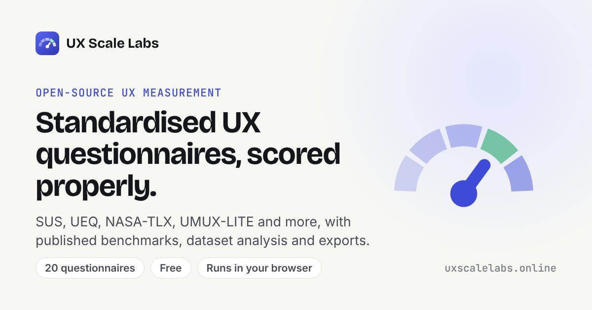

<div align="center">


# UX Scale Labs

Free calculators for SUS, UEQ, NASA-TLX and 17 other UX questionnaires, plus five stats tools. Everything runs in your browser.

[Website](https://uxscalelabs.online) · [Report a bug](https://github.com/cfunkz/UX-Scale-Labs-Docs/issues/new?labels=bug) · [Request a questionnaire](https://github.com/cfunkz/UX-Scale-Labs-Docs/issues/new?labels=questionnaire&title=Questionnaire%20request%3A%20) · [Ko-fi](https://ko-fi.com/cfunkz81112)

[](https://uxscalelabs.online)
[](LICENSE)
[](https://github.com/cfunkz/UX-Scale-Labs-Docs/stargazers)
[](https://github.com/cfunkz/UX-Scale-Labs-Docs/issues)
[](https://github.com/cfunkz/UX-Scale-Labs-Docs/commits)
<br>


[](https://ko-fi.com/cfunkz81112)

</div>

This is the public site repository for **[uxscalelabs.online](https://uxscalelabs.online)**, a free web tool for scoring UX questionnaires like SUS, UEQ and NASA-TLX.

There's no server or database behind it. Everything is worked out in the browser, so people's answers stay on their own computer.



## What it does

There are three parts to it.

**Questionnaires.** There are 20, each with its own page. A participant can fill one in and see their score straight away, then download it as a PDF, CSV, JSON or text file. Each page also has a "Score a dataset" tab for when you've got a whole study. You can upload or paste a table with one row per person, or drop in the result files your participants sent you. It gives you the mean, a confidence interval, Cronbach's alpha and a sentence you can paste into your write-up.

**Combine results** (`/combine/`). This is for when each participant did a questionnaire on the site and sent you their download. You drop all the files in at once and get everyone's scores, the group average and one dataset per questionnaire.

**Stats tools** (`/tools/`). Sample size, A/B tests, completion rates, time on task and Cronbach's alpha. I followed Sauro and Lewis's *Quantifying the User Experience* for the maths, and each tool gives an APA-style sentence at the end.

## The questionnaires

Most of these are validated questionnaires from published research. NPS, CSAT and CES are industry metrics, so they don't have the same academic backing, and the two "quick checks" are item sets I made for my own checks. The site marks which is which.

| Category | Questionnaire | Items | Response format | Status |
|---|---|:---:|---|---|
| Perceived usability | [System Usability Scale (SUS)](https://uxscalelabs.online/sus/) | 10 | 5-point | Validated |
| | [UMUX](https://uxscalelabs.online/umux/) | 4 | 7-point | Validated |
| | [UMUX-LITE](https://uxscalelabs.online/umux-lite/) | 2 | 7-point | Validated |
| | [CSUQ (version 3)](https://uxscalelabs.online/csuq/) | 16 | 7-point + N/A | Validated |
| | [PSSUQ (version 3)](https://uxscalelabs.online/pssuq/) | 16 | 7-point + N/A | Validated |
| Task level | [Single Ease Question (SEQ)](https://uxscalelabs.online/seq/) | 1 | 7-point | Validated |
| | [After-Scenario Questionnaire (ASQ)](https://uxscalelabs.online/asq/) | 3 | 7-point + N/A | Validated |
| | [NASA-TLX (Raw TLX)](https://uxscalelabs.online/nasa-tlx/) | 6 | 0–100 | Validated |
| UX and aesthetics | [User Experience Questionnaire (UEQ)](https://uxscalelabs.online/ueq/) | 26 | Semantic differential | Validated |
| | [UEQ-S](https://uxscalelabs.online/ueq-s/) | 8 | Semantic differential | Validated |
| | [VisAWI-S](https://uxscalelabs.online/visawi-s/) | 4 | 7-point | Validated |
| | [USE Questionnaire](https://uxscalelabs.online/use/) | 30 | 7-point | Industry |
| AI and automation | [Chatbot Usability Questionnaire (CUQ)](https://uxscalelabs.online/cuq/) | 16 | 5-point | Validated |
| | [Trust in Automated Systems](https://uxscalelabs.online/trust/) | 12 | 7-point | Validated |
| Acceptance | [Technology Acceptance Model (TAM)](https://uxscalelabs.online/tam/) | 12 | 7-point | Validated |
| Satisfaction and loyalty | [Net Promoter Score (NPS)](https://uxscalelabs.online/nps/) | 1 | 0–10 | Industry |
| | [Customer Satisfaction (CSAT)](https://uxscalelabs.online/csat/) | 1 | 5-point | Industry |
| | [Customer Effort Score (CES 2.0)](https://uxscalelabs.online/ces/) | 1 | 7-point | Industry |
| Quick checks | [Basic UX Pulse](https://uxscalelabs.online/basic-ux/) | 8 | 5-point | Not validated |
| | [Self-Reported Learnability](https://uxscalelabs.online/learnability/) | 6 | 7-point | Not validated |

I didn't include SUPR-Q, AttrakDiff, QUIS or WAMMI because you need a licence to use their items or norms.

Each questionnaire page has a "Method" tab showing how the score is calculated and where the method comes from, with the references as BibTeX. A few things that might catch you out:

- SUS uses Brooke's original scoring and the Sauro–Lewis grading curve, where 68 is average.
- UMUX-LITE shows both the raw score and the adjusted one that lines up with SUS.
- PSSUQ and ASQ keep their original direction, so a lower score is better.
- UEQ is compared against the benchmark from the UEQ handbook.
- NASA-TLX is the Raw TLX version, so it's a plain average with no pairwise weighting.

If a questionnaire doesn't have a published benchmark, the site just says so rather than making one up.

## Repository layout

This repository contains the built static website served at **[uxscalelabs.online](https://uxscalelabs.online)**:

```text
assets/
  js/            questionnaires, scoring, statistics, exports
  css/main.css   all the styling
