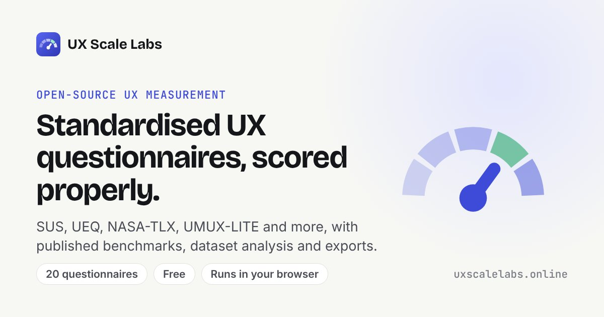

<div align="center">


# UX Scale Labs

Free calculators for SUS, UEQ, NASA-TLX and 17 other UX questionnaires, plus five stats tools. Everything runs in your browser.

[Website](https://uxscalelabs.online) · [Report a bug](https://github.com/cfunkz/UX-Scale-Labs/issues/new?labels=bug) · [Request a questionnaire](https://github.com/cfunkz/UX-Scale-Labs/issues/new?labels=questionnaire&title=Questionnaire%20request%3A%20) · [Ko-fi](https://ko-fi.com/cfunkz81112)

[](https://uxscalelabs.online)
[](LICENSE)
[](https://github.com/cfunkz/UX-Scale-Labs/stargazers)
[](https://github.com/cfunkz/UX-Scale-Labs/issues)
[](https://github.com/cfunkz/UX-Scale-Labs/commits)
<br>


[](https://ko-fi.com/cfunkz81112)

</div>

This is a website for scoring UX questionnaires like SUS, UEQ and NASA-TLX. It's free to use at **[uxscalelabs.online](https://uxscalelabs.online)**, and the code is here if you want to host your own copy.

There's no server or database behind it. Everything is worked out in the browser, so people's answers stay on their own computer.



## What it does

There are three parts to it.

**Questionnaires.** There are 20, each with its own page. A participant can fill one in and see their score straight away, then download it as a PDF, CSV, JSON or text file. Each page also has a "Score a dataset" tab for when you've got a whole study. You can upload or paste a table with one row per person, or drop in the result files your participants sent you. It gives you the mean, a confidence interval, Cronbach's alpha and a sentence you can paste into your write-up.

**Combine results** (`/combine/`). This is for when each participant did a questionnaire on the site and sent you their download. You drop all the files in at once and get everyone's scores, the group average and one dataset per questionnaire.

**Stats tools** (`/tools/`). Sample size, A/B tests, completion rates, time on task and Cronbach's alpha. I followed Sauro and Lewis's *Quantifying the User Experience* for the maths, and each tool gives an APA-style sentence at the end.

## The questionnaires

Most of these are validated questionnaires from published research. NPS, CSAT and CES are industry metrics, so they don't have the same academic backing, and the two "quick checks" are item sets I made for my own checks. The site marks which is which.

| Category | Questionnaire | Items | Response format | Status |
|---|---|:---:|---|---|
| Perceived usability | [System Usability Scale (SUS)](https://uxscalelabs.online/sus/) | 10 | 5-point | Validated |
| | [UMUX](https://uxscalelabs.online/umux/) | 4 | 7-point | Validated |
| | [UMUX-LITE](https://uxscalelabs.online/umux-lite/) | 2 | 7-point | Validated |
| | [CSUQ (version 3)](https://uxscalelabs.online/csuq/) | 16 | 7-point + N/A | Validated |
| | [PSSUQ (version 3)](https://uxscalelabs.online/pssuq/) | 16 | 7-point + N/A | Validated |
| Task level | [Single Ease Question (SEQ)](https://uxscalelabs.online/seq/) | 1 | 7-point | Validated |
| | [After-Scenario Questionnaire (ASQ)](https://uxscalelabs.online/asq/) | 3 | 7-point + N/A | Validated |
| | [NASA-TLX (Raw TLX)](https://uxscalelabs.online/nasa-tlx/) | 6 | 0–100 | Validated |
| UX and aesthetics | [User Experience Questionnaire (UEQ)](https://uxscalelabs.online/ueq/) | 26 | Semantic differential | Validated |
| | [UEQ-S](https://uxscalelabs.online/ueq-s/) | 8 | Semantic differential | Validated |
| | [VisAWI-S](https://uxscalelabs.online/visawi-s/) | 4 | 7-point | Validated |
| | [USE Questionnaire](https://uxscalelabs.online/use/) | 30 | 7-point | Industry |
| AI and automation | [Chatbot Usability Questionnaire (CUQ)](https://uxscalelabs.online/cuq/) | 16 | 5-point | Validated |
| | [Trust in Automated Systems](https://uxscalelabs.online/trust/) | 12 | 7-point | Validated |
| Acceptance | [Technology Acceptance Model (TAM)](https://uxscalelabs.online/tam/) | 12 | 7-point | Validated |
| Satisfaction and loyalty | [Net Promoter Score (NPS)](https://uxscalelabs.online/nps/) | 1 | 0–10 | Industry |
| | [Customer Satisfaction (CSAT)](https://uxscalelabs.online/csat/) | 1 | 5-point | Industry |
| | [Customer Effort Score (CES 2.0)](https://uxscalelabs.online/ces/) | 1 | 7-point | Industry |
| Quick checks | [Basic UX Pulse](https://uxscalelabs.online/basic-ux/) | 8 | 5-point | Not validated |
| | [Self-Reported Learnability](https://uxscalelabs.online/learnability/) | 6 | 7-point | Not validated |

I didn't include SUPR-Q, AttrakDiff, QUIS or WAMMI because you need a licence to use their items or norms.

Each questionnaire page has a "Method" tab showing how the score is calculated and where the method comes from, with the references as BibTeX. A few things that might catch you out:

- SUS uses Brooke's original scoring and the Sauro–Lewis grading curve, where 68 is average.
- UMUX-LITE shows both the raw score and the adjusted one that lines up with SUS.
- PSSUQ and ASQ keep their original direction, so a lower score is better.
- UEQ is compared against the benchmark from the UEQ handbook.
- NASA-TLX is the Raw TLX version, so it's a plain average with no pairwise weighting.

If a questionnaire doesn't have a published benchmark, the site just says so rather than making one up.

## Running it locally

You'll need [Node.js](https://nodejs.org) 18 or newer and Git.

```bash
git clone https://github.com/cfunkz/UX-Scale-Labs.git
cd UX-Scale-Labs
npm run serve    # site runs at http://localhost:4173
```

If you change anything, rebuild and run the tests:

```bash
npm run build
npm test
```

The HTML in `docs/` is generated by the build, so edit the files in `scripts/` and `docs/assets/js/` instead. Also, the site caches itself so it works offline, which means you sometimes have to reload twice before a change shows up.

## Hosting your own copy

GitHub Pages is the easiest option and it's free.

1. Fork this repo.
2. Clone your fork, set `site_url` in `settings.yml` to your address (see [Settings](#settings)) and run `npm run build`. This also sets `docs/CNAME`. Then commit and push the updated `docs/` folder.
3. Go to Settings → Pages, choose "Deploy from a branch", pick `main` and the `/docs` folder, and save.

One catch: the links start from the root of the domain (like `/sus/`), so the site won't work from a sub-folder. Either use a custom domain or name your fork `your-username.github.io`. For a custom domain, put it in `site_url`, run `npm run build`, then follow [GitHub's guide](https://docs.github.com/en/pages/configuring-a-custom-domain-for-your-github-pages-site) to point the domain at Pages.

Netlify, Cloudflare Pages or any other static host works too. You just need to serve the `docs` folder.

## Settings

All the main details live in `settings.yml` in the root of the repo. Change the values and run `npm run build`. Nothing in it is secret, since it all ends up in the public pages anyway. If you deploy from GitHub Pages, the built files in `docs/` are what gets published, so remember to build and commit `docs/` after changing anything.

| Setting | What it's for |
|---|---|
| `site_name` | The name in the header, page titles and footer. |
| `short_name` | The shorter name used when someone adds the site to their phone's home screen. |
| `site_url` | Your site's address. Used for links, the sitemap and social previews. The build also writes `docs/CNAME` from it, or removes it for a `*.github.io` address. |
| `github_repo` | Link to your repo in the header and footer. Leave it empty to hide it. |
| `kofi_url` | Ko-fi link in the footer. Leave it empty to hide it. |
| `logo` | Path to your own logo as an SVG, e.g. `brand/logo.svg`. Leave it empty to keep the built-in one. Run `npm run icons` afterwards to remake the PNG icons and preview images. |
| `adsense_client` | Your Google AdSense ID (`ca-pub-…`). It's set to mine at the moment, so change it or leave it empty for no ads. |
| `ga_id` | Your Google Analytics ID (`G-…`). Leave it empty if you don't want analytics. It never records anyone's answers either way. |
| `contact_email` | Shown on the privacy page. If it's empty, people get pointed to GitHub issues instead. |
| `privacy_updated` | The date shown on the privacy page. |

The privacy page changes depending on whether ads and analytics are switched on. If you do use ads, set up the consent message in AdSense under Privacy & messaging so that visitors in the UK and EU get asked first.

## Adding a questionnaire

1. Copy a similar entry in `docs/assets/js/scales.js` and edit it: the `id` (which becomes the URL), name, items, response range, scoring method and references.
2. If none of the scoring functions in `docs/assets/js/scoring.js` fit, write a new one.
3. Add a short `seo` entry near the bottom of `scales.js` (page title, search phrases, related scales).
4. Run `npm run build` and `npm test`. If you want a social preview image for it as well, run `npm run icons` (run `npm run icons:setup` the first time).

## Where things are

```
docs/                  the website itself (this is what gets hosted)
  assets/js/           questionnaires, scoring, statistics, exports
  assets/css/main.css  all the styling
scripts/               builds the HTML pages from the data
tests/                 checks the scoring and statistics
```

You'll mostly be editing `docs/assets/js/scales.js` (the questionnaires), `docs/assets/js/scoring.js` (how they're scored), `settings.yml` (site settings), `scripts/templates.mjs` (page layout) and `scripts/tools.mjs` (the text on the stats tools and combine page).

## A few caveats

This helps with the scoring, but it isn't a substitute for reading the original papers. If you're using the numbers in research, check the sources and cite the original authors rather than this site. Benchmarks like the SUS grades come from specific products and samples, so they won't suit every study. The VisAWI-S wording comes from secondary sources, so compare it with the official manual if you're using it formally. It's only in English for now.

I'm not affiliated with any of the questionnaire authors.

If you spot a mistake or want a questionnaire added, open an issue or a pull request.

## References

<details>
<summary>Show references</summary>

Bangor, A., Kortum, P. T., & Miller, J. T. (2008). An empirical evaluation of the System Usability Scale. *International Journal of Human–Computer Interaction, 24*(6), 574–594. https://doi.org/10.1080/10447310802205776

Brooke, J. (1996). SUS: A "quick and dirty" usability scale. In P. W. Jordan, B. Thomas, B. A. Weerdmeester, & I. L. McClelland (Eds.), *Usability evaluation in industry* (pp. 189–194). Taylor & Francis.

Davis, F. D. (1989). Perceived usefulness, perceived ease of use, and user acceptance of information technology. *MIS Quarterly, 13*(3), 319–340. https://doi.org/10.2307/249008

Dixon, M., Toman, N., & DeLisi, R. (2013). *The effortless experience: Conquering the new battleground for customer loyalty*. Portfolio/Penguin.

Finstad, K. (2010). The usability metric for user experience. *Interacting with Computers, 22*(5), 323–327. https://doi.org/10.1016/j.intcom.2010.04.004

Hart, S. G. (2006). NASA-Task Load Index (NASA-TLX); 20 years later. *Proceedings of the Human Factors and Ergonomics Society Annual Meeting, 50*(9), 904–908. https://doi.org/10.1177/154193120605000909

Hart, S. G., & Staveland, L. E. (1988). Development of NASA-TLX (Task Load Index): Results of empirical and theoretical research. *Advances in Psychology, 52*, 139–183. https://doi.org/10.1016/S0166-4115(08)62386-9

Holmes, S., Moorhead, A., Bond, R., Zheng, H., Coates, V., & McTear, M. (2019). Usability testing of a healthcare chatbot: Can we use conventional methods to assess conversational user interfaces? In *Proceedings of the 31st European Conference on Cognitive Ergonomics* (pp. 207–214). https://doi.org/10.1145/3335082.3335094

Jian, J.-Y., Bisantz, A. M., & Drury, C. G. (2000). Foundations for an empirically determined scale of trust in automated systems. *International Journal of Cognitive Ergonomics, 4*(1), 53–71. https://doi.org/10.1207/S15327566IJCE0401_04

Laugwitz, B., Held, T., & Schrepp, M. (2008). Construction and evaluation of a user experience questionnaire. In A. Holzinger (Ed.), *HCI and usability for education and work* (pp. 63–76). Springer. https://doi.org/10.1007/978-3-540-89350-9_6

Lewis, J. R. (1991). Psychometric evaluation of an after-scenario questionnaire for computer usability studies: The ASQ. *ACM SIGCHI Bulletin, 23*(1), 78–81. https://doi.org/10.1145/122672.122692

Lewis, J. R. (1995). IBM computer usability satisfaction questionnaires: Psychometric evaluation and instructions for use. *International Journal of Human–Computer Interaction, 7*(1), 57–78. https://doi.org/10.1080/10447319509526110

Lewis, J. R. (2002). Psychometric evaluation of the PSSUQ using data from five years of usability studies. *International Journal of Human–Computer Interaction, 14*(3–4), 463–488. https://doi.org/10.1080/10447318.2002.9669130

Lewis, J. R. (2018). Measuring perceived usability: The CSUQ, SUS, and UMUX. *International Journal of Human–Computer Interaction, 34*(12), 1148–1156. https://doi.org/10.1080/10447318.2017.1418805

Lewis, J. R., Utesch, B. S., & Maher, D. E. (2013). UMUX-LITE: When there's no time for the SUS. In *Proceedings of the SIGCHI Conference on Human Factors in Computing Systems* (pp. 2099–2102). https://doi.org/10.1145/2470654.2481287

Lund, A. M. (2001). Measuring usability with the USE questionnaire. *STC Usability SIG Newsletter, 8*(2).

Moshagen, M., & Thielsch, M. T. (2013). A short version of the visual aesthetics of websites inventory. *Behaviour & Information Technology, 32*(12), 1305–1311. https://doi.org/10.1080/0144929X.2012.694910

Reichheld, F. F. (2003). The one number you need to grow. *Harvard Business Review, 81*(12), 46–54.

Sauro, J., & Dumas, J. S. (2009). Comparison of three one-question, post-task usability questionnaires. In *Proceedings of the SIGCHI Conference on Human Factors in Computing Systems* (pp. 1599–1608). https://doi.org/10.1145/1518701.1518946

Sauro, J., & Lewis, J. R. (2016). *Quantifying the user experience: Practical statistics for user research* (2nd ed.). Morgan Kaufmann.

Schrepp, M., Hinderks, A., & Thomaschewski, J. (2017). Construction of a benchmark for the User Experience Questionnaire (UEQ). *International Journal of Interactive Multimedia and Artificial Intelligence, 4*(4), 40–44. https://doi.org/10.9781/ijimai.2017.445

Schrepp, M., Hinderks, A., & Thomaschewski, J. (2017). Design and evaluation of a short version of the User Experience Questionnaire (UEQ-S). *International Journal of Interactive Multimedia and Artificial Intelligence, 4*(6), 103–108. https://doi.org/10.9781/ijimai.2017.09.001

</details>

## Licence

MIT, see [LICENSE](LICENSE).
